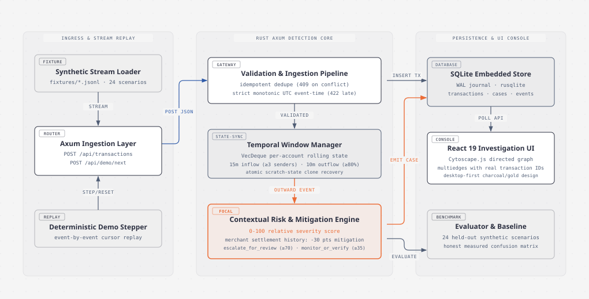
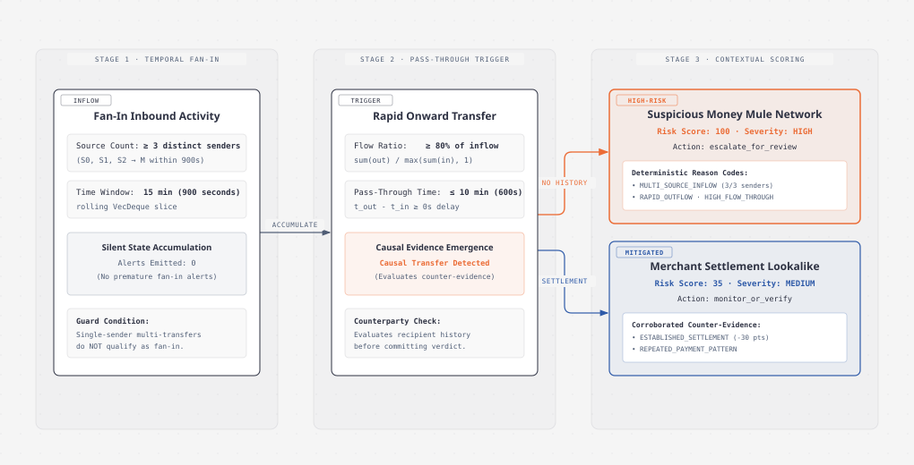

# blindspot.

> *Fraud hides in plain sight.*

Blindspot is a desktop-first investigation console built in Rust and React for detecting rapid money-mule pass-through networks in high-velocity payment streams. It pairs rolling in-memory graph flow tracking with historical account context to catch fan-in money dispersion while filtering out legitimate merchant settlement lookalikes.

---



---

## What It Is & Why It Exists

Real-time payment systems like UPI, Faster Payments, FedNow, and SEPA Instant settle transfers in seconds. This speed gives illicit networks a narrow window to disperse money: funds from multiple compromised accounts or victims are funneled into an intermediary account ("fan-in") and immediately transferred onward to a cash-out destination ("rapid pass-through").

Traditional rules-based Anti-Money Laundering (AML) monitoring systems struggle with this pattern for two reasons:

1. **Isolated transaction analysis:** Evaluating transfers one-by-one misses the multi-source aggregation shape entirely unless arbitrary aggregate queries run against slow analytical databases.
2. **False positives on merchant settlements:** E-commerce sellers and retail merchants receive hundreds of customer payments and transfer net earnings daily to supplier or settlement accounts. A naive rules engine flagging rapid fan-in and outflow flags legitimate merchants at high rates, overwhelming compliance analysts.

Blindspot addresses both challenges:
- **Temporal graph detection:** It tracks sliding 15-minute inbound and 10-minute outbound windows per account in-memory, requiring at least three distinct sources and an 80% flow-through ratio before raising a candidate.
- **Contextual mitigation:** It cross-references the destination account against historical recurring settlement patterns. Corroborated merchant settlements receive an automatic 30-point risk mitigation, keeping cases in a medium monitoring state rather than triggering high-priority escalations.
- **Explainable evidence:** Cases are published with deterministic reason codes and an interactive directed graph preserving real transaction IDs across multi-edges.

---

## Where and How It Can Be Used

Blindspot is designed for financial crime monitoring scenarios where low latency, causal explainability, and analyst productivity are essential:

- **Fintech & Neobank Risk Operations:** Real-time screening of newly onboarded accounts for mule activity during introductory promotional or transaction-volume spikes.
- **Payment Gateways & Aggregators:** Disentangling high-velocity buyer payments from suspicious pass-through routing without interrupting verified merchant payouts.
- **AML / Fraud Investigation Desks:** Providing analysts with an interactive timeline and visual transaction graph instead of raw tabular database logs.
- **Synthetic Benchmarking & Simulation Testbeds:** Evaluating detection rules and heuristics against controlled multi-party synthetic scenarios prior to production deployment.

> **Scope Note:** Blindspot is an investigation decision-support tool, not an automated fund-freezing engine. All generated risk scores (0–100) are hand-engineered relative severity rankings, not calibrated probabilities. All demo data is **SIMULATED / SYNTHETIC**.

---

## Detection Logic & Typology Flow

The engine uses a two-phase temporal state machine with contextual mitigation:

---



---

### Phase 1: Temporal Fan-In Inflow
- An account receives transfers from **at least 3 distinct sender accounts** within a rolling 900-second (15-minute) window.
- Multiple transfers from the same sender do not increment the unique sender count.
- **Causal Guarantee:** During this stage, **zero alerts are fired**. Legitimate accounts regularly receive multiple deposits. State accumulates silently in a rolling `VecDeque`.

### Phase 2: Rapid Pass-Through Outflow
- Following eligible inbound activity, the subject account executes an outward transfer within 600 seconds (10 minutes).
- The outbound transfer must satisfy an 80% pass-through ratio:
  $$\text{flow\_ratio} = \min\left(1.0, \frac{\sum \text{out\_amounts}}{\max(\sum \text{in\_amounts}, 1)}\right) \ge 0.80$$
- This outward transfer serves as the **causal trigger event**.

### Phase 3: Contextual Mitigation & Case Formation
The engine evaluates prior account context against the candidate:
- **Suspicious Money Mule (Scenario S4):** The recipient is previously unseen with zero recurring settlement history. The engine emits a **High Severity** case (Risk Score: 100, Action: `escalate_for_review`) with reason codes `MULTI_SOURCE_INFLOW`, `RAPID_OUTFLOW`, and `HIGH_FLOW_THROUGH`.
- **Merchant Settlement Lookalike (Scenario S3):** The recipient matches an established, recurring settlement history outside the current window. The engine subtracts 30 mitigation points, yielding a **Medium Severity** case (Risk Score: 35, Action: `monitor_or_verify`) with reason codes `ESTABLISHED_SETTLEMENT` and `REPEATED_PAYMENT_PATTERN`.

---

## Tech Stack & Prerequisites

### Prerequisites

| Tool | Version | Purpose |
|---|---|---|
| **Rust & Cargo** | 1.80+ | Backend compiler and package manager |
| **C Toolchain** | MSVC, GCC, or Clang | Native C compilation for embedded SQLite (`rusqlite`) |
| **Node.js & npm** | Node 20+ LTS | Frontend development environment and package manager |

### Technology Breakdown

- **Backend (Rust)**
  - **Runtime & Web:** `axum` 0.8 on `tokio` (multi-threaded async runtime).
  - **Persistence:** `rusqlite` (embedded SQLite with Write-Ahead Logging mode enabled).
  - **State Management:** In-memory `HashMap<AccountId, AccountState>` with rolling `VecDeque` windows. Atomic scratch-state cloning ensures zero state corruption during transaction rollback.
  - **Graph Representation:** Directed graph projection using `petgraph` structures, preserving multi-edges with unique transaction IDs.
  - **Serialization & Time:** `serde`, `serde_json`, `chrono` (strict RFC 3339 UTC timestamps).
- **Frontend (TypeScript & React)**
  - **UI Framework:** React 19, TypeScript 5.8, Vite 6.
  - **Graph Visualization:** `cytoscape` with custom breadthfirst/cose graph styling.
  - **Design System:** Desktop-first high-contrast charcoal and gold visual aesthetic.
  - **Icons:** `lucide-react`.
- **Verification & QA**
  - **Cargo Test Suite:** 15 contract, pipeline, and unit tests.
  - **End-to-End & A11y:** Playwright integration suite.
  - **Wire Verification Harness:** Standalone Node.js test suite (`qa/harness.mjs`).

---

## Quickstart: Running Locally

Clone the repository and run backend and frontend in separate terminals:

### 1. Start the Backend

```powershell
cd backend
cargo run
```

The Axum server initializes SQLite storage, seeds baseline account profiles, and listens on `http://127.0.0.1:3001`.

### 2. Start the Frontend

```powershell
cd frontend
npm ci
npm run dev
```

Open `http://127.0.0.1:5173` in your browser. Vite proxies `/api` requests directly to `http://127.0.0.1:3001`.

---

## Stepping Through the Interactive Demo

You can control transaction ingestion directly through the UI buttons or via PowerShell / cURL:

### Test Case 1: Suspicious Money Mule Replay

Reset to the mule scenario and step through four transactions:

```powershell
# Reset to mule scenario
Invoke-RestMethod -Method Post http://127.0.0.1:3001/api/demo/reset `
  -ContentType application/json -Body '{"scenario":"mule_fan_in_pass_through"}'

# Step transactions 1, 2, 3 (fan-in transfers)
1..3 | ForEach-Object { 
  Invoke-RestMethod -Method Post http://127.0.0.1:3001/api/demo/next -ContentType application/json -Body '{}'
}

# Verify 0 cases exist before outward transfer
Invoke-RestMethod http://127.0.0.1:3001/api/cases

# Step transaction 4 (rapid outward transfer)
Invoke-RestMethod -Method Post http://127.0.0.1:3001/api/demo/next -ContentType application/json -Body '{}'

# Verify high-severity case emerges
Invoke-RestMethod http://127.0.0.1:3001/api/cases
```

**Result:** The first three inbound transfers produce zero cases. Stepping the fourth outward transfer immediately creates `case-000001` with a risk score of 100, severity `high`, and recommended action `escalate_for_review`.

### Test Case 2: Merchant Settlement Lookalike

```powershell
# Reset to legitimate merchant scenario
Invoke-RestMethod -Method Post http://127.0.0.1:3001/api/demo/reset `
  -ContentType application/json -Body '{"scenario":"merchant_legitimate"}'

# Step all 4 events
1..4 | ForEach-Object { 
  Invoke-RestMethod -Method Post http://127.0.0.1:3001/api/demo/next -ContentType application/json -Body '{}'
}

# Inspect mitigated case
Invoke-RestMethod http://127.0.0.1:3001/api/cases
```

**Result:** A case is formed to keep the flow inspectable, but risk score is mitigated to 35, severity is set to `medium`, and recommended action is `monitor_or_verify`.

---

## API Wire Contracts

All monetary amounts are represented as **signed 64-bit positive integers in minor currency units** (paise for INR; ₹30,000 = `3000000`). All timestamps are RFC 3339 UTC.

### Core Endpoints

| Method | Route | Description |
|---|---|---|
| `GET` | `/api/health` | Service status, source mode (`synthetic`), and version |
| `POST` | `/api/transactions` | Ingest single transaction with deduplication and validation |
| `GET` | `/api/transactions` | Paginated transaction feed (supports `limit` and `cursor`) |
| `GET` | `/api/cases` | Summary list of all detected investigation cases |
| `GET` | `/api/cases/:id` | Detailed case record including reason codes and account list |
| `GET` | `/api/cases/:id/graph` | Directed Cytoscape node/edge graph projection |
| `POST` | `/api/demo/next` | Step next sequential transaction in active scenario |
| `POST` | `/api/demo/reset` | Destructive reset loading a scenario (`mule_fan_in_pass_through`, etc.) |
| `GET` | `/api/metrics` | Retrieve measured benchmark performance against baseline |
| `POST` | `/api/evaluate` | Execute isolated benchmark against all 24 held-out scenarios |

### Sample Transaction Ingest Payload

```json
{
  "transaction_id": "tx-10023",
  "timestamp": "2026-10-13T10:20:00Z",
  "source_account_id": "bankA:acct-001",
  "destination_account_id": "bankA:acct-009",
  "amount_minor": 3000000,
  "currency": "INR",
  "channel": "synthetic_stream"
}
```

- Duplicate transaction ID with identical content: Returns HTTP `200` (`accepted: true, duplicate: true`) with no state mutation.
- Duplicate transaction ID with conflicting amount or destination: Returns HTTP `409 CONFLICTING_TRANSACTION_ID`.
- Late or out-of-order event (`timestamp < last_event_time`): Returns HTTP `422 OUT_OF_ORDER_EVENT`.

---

## Measured Benchmark Evaluation

Blindspot includes a benchmark runner evaluating the detection engine against a simple rules-only baseline across 24 held-out synthetic scenarios (8 suspicious mule networks, 16 benign and merchant lookalikes).

To execute the benchmark:

```powershell
cd backend
cargo run -- --evaluate
```

### Measured Benchmark Scoreboard (`held_out_synthetic_v1`)

| Metric | Rules-Only Baseline | Blindspot Engine |
|---|---|---|
| **True Positives (TP)** | 6 | **8** |
| **False Positives (FP)** | 10 | **0** |
| **False Negatives (FN)** | 2 | **0** |
| **True Negatives (TN)** | 6 | **16** |
| **Precision** | 37.5% | **100.0%** |
| **Recall** | 75.0% | **100.0%** |
| **False Positive Rate** | 62.5% | **0.0%** |
| **Decision Latency (p50)** | 0.18 ms | **0.17 ms** |
| **Decision Latency (p95)** | 0.41 ms | **0.45 ms** |

> **Measurement Scope:** Latency figures measure CPU processing time (validation, in-memory state traversal, and SQLite commit) using `std::time::Instant`. Metrics apply to the 24 synthetic scenarios and do not constitute real-world production performance claims.

---

## Quality Gates & Verification

Run all test suites locally:

```powershell
# 1. Rust formatting and tests
cd backend
cargo fmt --check
cargo test
cargo build

# 2. Frontend typecheck and production bundle
cd ../frontend
npm run build

# 3. Independent API Wire Contract Harness (57 tests)
cd ..
node qa/harness.mjs
```

---

## Repository Structure

```text
synesis/
├── backend/                  # Rust Axum backend
│   ├── src/
│   │   ├── main.rs           # Entry point and CLI flag parsing
│   │   ├── api.rs            # Axum HTTP route handlers and DTOs
│   │   ├── config.rs         # Centralized detector thresholds
│   │   ├── detection.rs      # Temporal fan-in & pass-through evaluation
│   │   ├── scoring.rs        # Contextual scoring and merchant mitigation
│   │   ├── store.rs          # SQLite persistence and scratch-state cloning
│   │   ├── evaluation.rs     # Held-out benchmark and baseline runner
│   │   └── types.rs          # Core domain models and reason codes
│   └── tests/                # Integration and contract tests
├── frontend/                 # Vite + React + TypeScript web app
│   ├── src/
│   │   ├── components/       # Monitor, case queue, Cytoscape graph, inspector
│   │   ├── api.ts            # Typed HTTP client with error handling
│   │   └── App.tsx           # Layout, polling loop, and state wiring
│   └── tests/                # Playwright browser and accessibility specs
├── fixtures/                 # Synthetic transaction streams (JSONL)
│   ├── mule_fan_in_pass_through.jsonl
│   ├── merchant_legitimate.jsonl
│   └── held_out/             # 24 held-out benchmark scenarios
├── docs/                     # Full technical specifications
│   ├── assets/               # Architecture and detection flow SVGs
│   ├── API_AND_DATABASE.md   # Wire contracts and database schema
│   ├── DETECTION_ENGINE.md   # Mathematical detection rules and thresholds
│   └── ARCHITECTURE.md       # Concurrency and state boundary design
└── qa/                       # Independent test runner and verification report
```

---

## Agent Development & Branching Workflow

All automated coding agents and contributors must follow this lifecycle for any new task or feature:

1. **Feature Branch Creation:**
   Create an isolated branch from `main` before starting modifications:
   ```bash
   git checkout -b feature/<task-name>
   ```
2. **Atomic Commits:**
   Keep commits focused on single working increments with conventional commit messages (`feat:`, `fix:`, `test:`, `refactor:`). Never commit unverified broken states.
3. **Quality Gate Validation & Merge:**
   After all tests (`cargo test`, `npm run build`, `qa/harness.mjs`) pass cleanly:
   ```bash
   git checkout main
   git merge --no-ff feature/<task-name> -m "feat(<scope>): complete <task-name>"
   git branch -d feature/<task-name>
   ```

---

## License

This project is licensed under the MIT License. All data and transaction histories are strictly synthetic.

